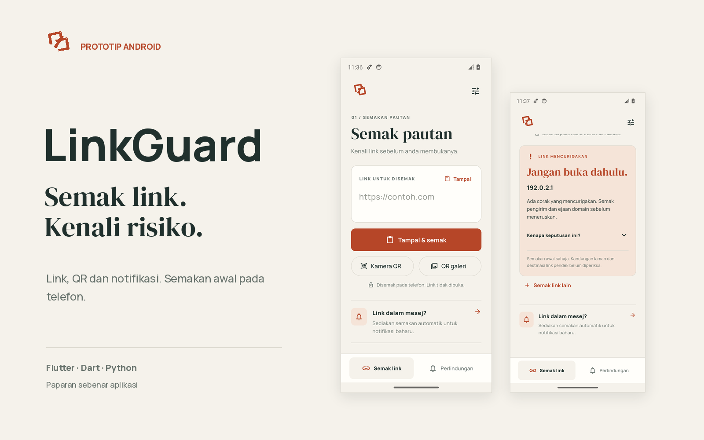
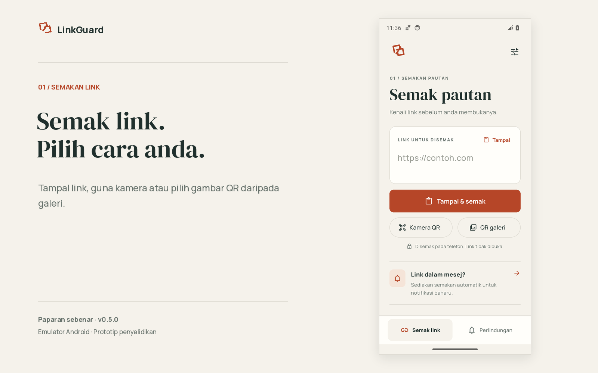
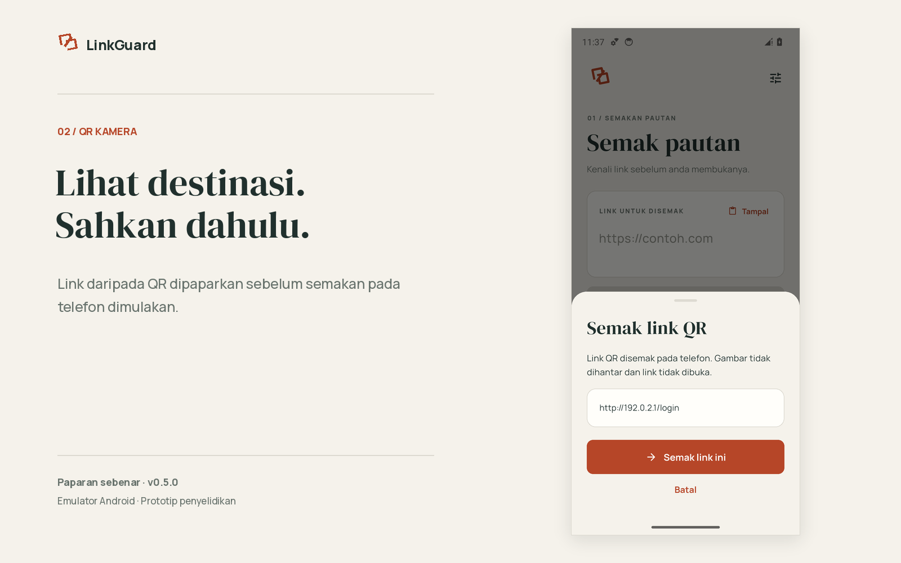
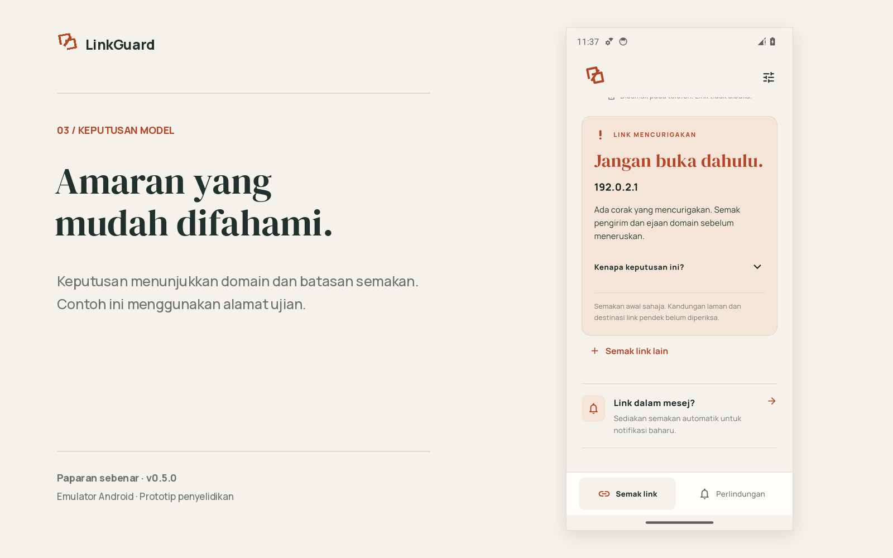

# LinkGuard — Phishing Link & QR Scanner

An Android research prototype built with **Flutter/Dart**, an on-device URL classifier and an
optional **Python FastAPI** backend. It checks link structure without opening the destination.
Available in **Bahasa Melayu and English**.



> Research prototype, v0.5.0. A result is not a safety guarantee. The model has not been qualified
> for daily protection, fresh phishing campaigns or Malaysian field traffic.

## Features

- **Manual checks:** paste/type a URL or share one from another app. Multiple shared links open
  a chooser, and editing the URL clears its previous verdict.
- **Camera and gallery QR:** decode on the phone, review the actual HTTP(S) destination and
  confirm before checking. QR links always use the on-device model; images are not uploaded.
- **Notification warnings:** opt in, grant Android notification access/warning permission and
  choose source apps. A headless Dart engine checks links and posts generic warnings.
  Pause/resume and temporary hash-based duplicate suppression are included.
- **Two languages:** UI and background warnings follow a saved BM/English preference.

| Home | QR confirmation | Example warning |
| --- | --- | --- |
|  |  |  |

Screenshots use synthetic test inputs. They do not demonstrate real-world detection accuracy.

## Project structure

| Directory | Contents |
| --- | --- |
| `mobile/` | Flutter UI, local classifier, QR decoder and Android platform bridge |
| `backend/` | Optional Python API and API tests |
| `ml/` | Dataset cleaning, feature extraction, training and tests |
| `models/` | Frozen research model exported to JSON |
| `contracts/` | Python/Dart golden vectors |
| `reports/` | Public training metrics and verification summary |
| `docs/` | Model card, privacy notes and screenshots |
| `tools/` | Build, model-sync, dataset-download and verification helpers |

Kotlin provides Android integration only. UI, QR decoding and mobile inference are Dart;
training and the optional backend are Python.

## Run the app

Verified with Flutter 3.47.2 / Dart 3.13.2, Android SDK 36 and Android Studio's JDK 25.
The app supports Android SDK 26 and newer. Android 14/API 34 emulator checks are recorded;
physical devices and iOS have not been validated.

```sh
git clone https://github.com/DevFaeez/linkguard-phishing-scanner.git
cd linkguard-phishing-scanner/mobile
flutter pub get
flutter run
```

For a debug APK, use `flutter build apk --debug --target-platform android-arm64`.
No API key is needed for local checks or QR decoding. Android camera and notification permissions
are requested only for the corresponding features. Gallery selection does not require broad
storage access. Rebuild the app after plugin/native changes; hot reload alone is insufficient.

On macOS/exFAT, Gradle keeps intermediates on the host's temporary filesystem and filters `._*`
resource sidecars. Source can remain on an external drive. Final outputs are copied to the
normal `mobile/build/app/outputs/` locations. Do not change the pinned Flutter lockfile casually.

## Optional Python backend

From the repository root:

```sh
python3 -m venv backend/.venv
backend/.venv/bin/python -m pip install -r backend/requirements-lock.txt
backend/.venv/bin/python -m backend.run
```

The development service binds to `http://127.0.0.1:18786`; API docs are at `/docs`. The Android
emulator reaches it through `http://10.0.2.2:18786`. Enable it in **Settings → Advanced options →
Check using a server**, with explicit consent for the session. QR and notification checks stay
on-device. HTTP is restricted to debug loopback/emulator hosts; other connections require HTTPS.

The launcher disables access logs. Submitted destinations are neither fetched nor persisted.
There is no public deployment, authentication or rate limiting; add these before external hosting.

## Tests and build helper

```sh
# From mobile/
flutter analyze
flutter test

# From the repository root, after creating the ML environment below
PYTHONPATH=ml .venv/bin/python -m pytest ml/tests -q
backend/.venv/bin/python -m pytest backend/tests -q
```

`tools/build_android.sh` runs analysis, tests and a debug build in a clean temporary mirror.
Put Flutter on `PATH` (or set `FLUTTER_BIN` for the preparation helper) and configure the Android
SDK through `ANDROID_HOME` or `ANDROID_SDK_ROOT` when needed. Outputs, environments and local
SDK paths are deliberately excluded from Git.

The QR phase recorded 35 Flutter tests, including 259 Python/Dart parity vectors. See
[the verification summary](reports/verification.json) for the latest checked scope.
Emulator helpers clear app test state: use a disposable `emulator-*` device only.

## Model and retraining

The frozen model uses **18 URL-derived features → StandardScaler → LogisticRegression**.
Its parameters are exported to JSON for Dart inference. It does not inspect page content,
follow redirects, expand short links or classify arbitrary message text/images.

```sh
python3 -m venv .venv
.venv/bin/python -m pip install -r ml/requirements-lock.txt
.venv/bin/python tools/download_dataset.py
PYTHONPATH=ml .venv/bin/python -m linkguard_ml.train
.venv/bin/python tools/sync_model.py
```

Raw data and processed split manifests are kept local and ignored. The downloader retrieves
only the public UCI archive; it does not visit URLs contained in the dataset. Training uses
registered-domain-separated train/validation/test splits, and selects the threshold on validation.
Do not promote a retrained model without independent evaluation.

Historical test split: **98.64% precision**, **98.82% recall**, **0.975% false positive rate**.
These figures come from one dataset and are not expected live-notification performance or
calibrated probabilities. Details: [model card](docs/MODEL_CARD.md),
[training metrics](reports/training.json).

## Privacy and repository safety

No URL, message or sender history is stored. Notifications and QR stay on-device; manual server
mode sends a URL only after session opt-in. Camera frames are transient, selected-image cache
copies are cleaned up, and Android backup/device transfer are excluded. Android may redact
notification text, suppress warnings or interrupt services; force stop prevents guaranteed scanning.

Credentials, signing keys, local SDK paths, datasets, logs, APKs, caches and macOS sidecars are
ignored and checked by the staged-file guard. Enable the local hook after cloning:

```sh
git config core.hooksPath .githooks
```

The hook checks staged filenames/content; if Gitleaks is installed it also runs its staged secret
scan. Never put credentials in Dart defines, source or APK assets. See [security](SECURITY.md)
and [privacy notes](docs/PRIVACY.md).

## Attribution

Prasad, A. & Chandra, S. (2024). *PhiUSIIL Phishing URL (Website)*, UCI #967, **CC BY 4.0**.
[Dataset](https://archive.ics.uci.edu/dataset/967/phiusiil+phishing+url+dataset) ·
[Paper](https://doi.org/10.1016/j.cose.2023.103545).
Original labels are `1 = legitimate`, `0 = phishing`; this project's targets invert them.

Manrope and DM Serif Display are bundled under the SIL Open Font License; their license texts
are in `mobile/assets/fonts/` and included in the app's license view. Third-party notices remain
with their dependencies. This repository does not include a production signing key or store release.
